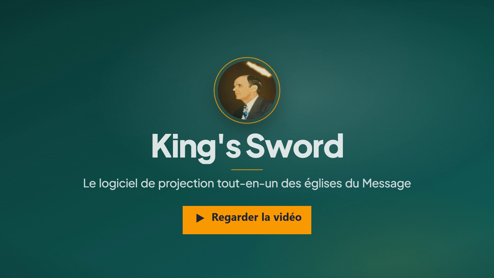
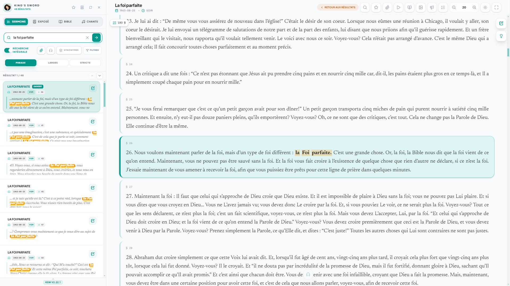
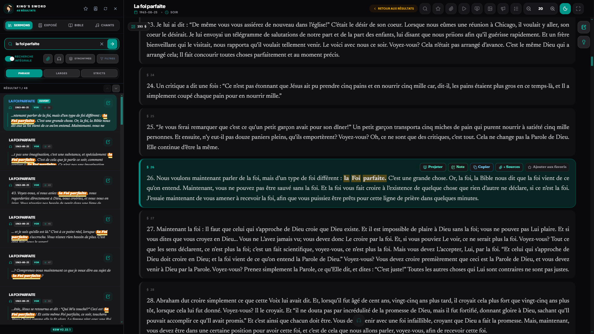
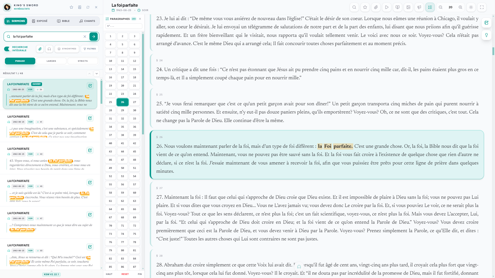
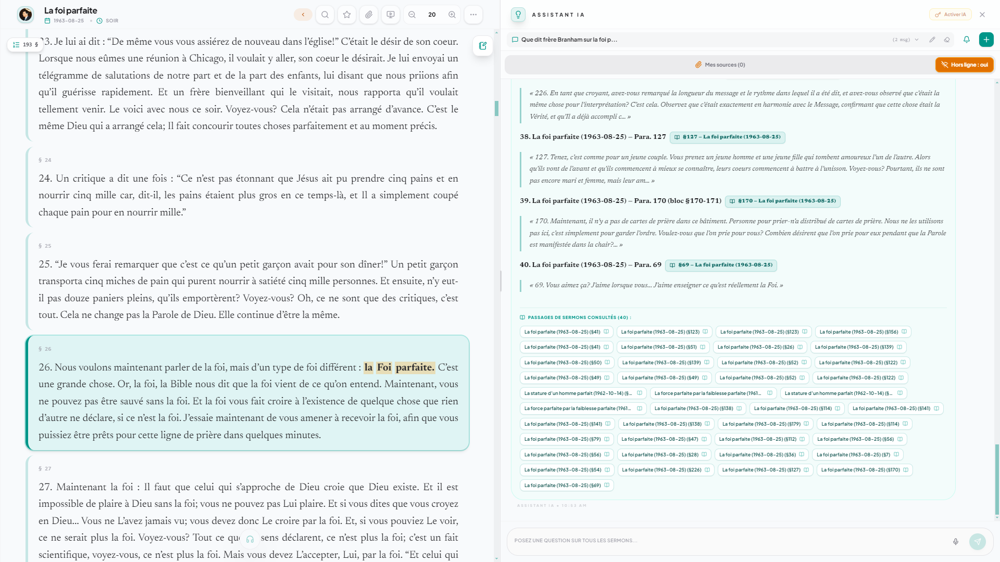
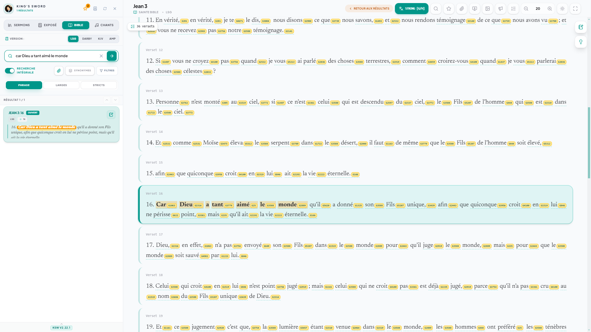
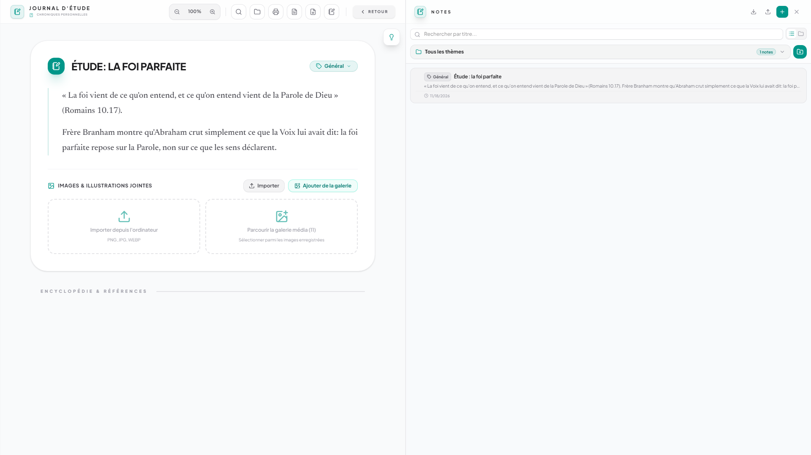
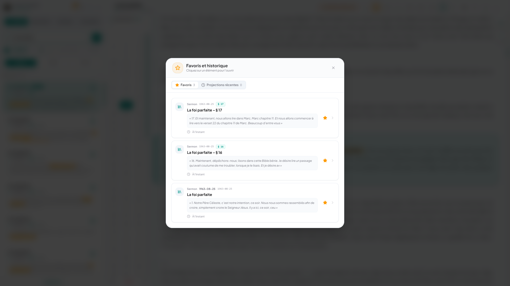
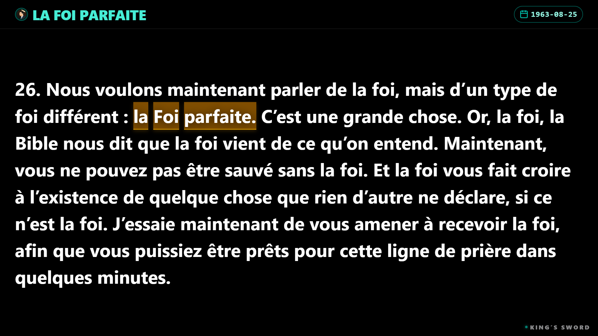
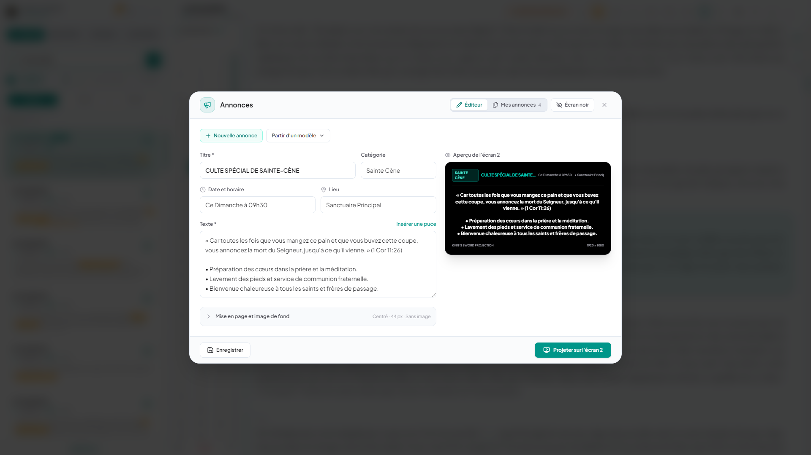

# King's Sword

### Le logiciel de projection tout-en-un des églises du Message

Citations des sermons de frère William Marrion Branham, Exposé des Sept Âges de l'Église, Sainte Bible et cantiques :
tout se projette depuis un seul logiciel, fluide et sans Internet.
Et en plus, dialoguez désormais avec le Message grâce à l'Assistant IA.

**[⬇ Télécharger King's Sword pour Windows](https://github.com/boukamass/King-s-Sword-Telechargement/releases/latest)**

Gratuit · En français · Fonctionne hors ligne · Windows 10 et 11

---

## Découvrir King's Sword en vidéo

*Cliquez sur l'image pour regarder la vidéo de présentation (1 min 40, 11 Mo).*

## Pourquoi King's Sword ?

Pendant le culte, projeter une citation, puis un verset, puis un cantique demandait jusqu'ici plusieurs logiciels.
King's Sword centralise tout : sermons, Bible, chants et annonces se projettent depuis une seule application, de façon
fluide et facile. Et grâce à son Assistant IA, il devient aussi un outil d'étude très puissant : posez vos questions
sur tout le Message ou sur quelques sermons choisis, et recevez des réponses appuyées par les citations exactes.

| Ce qui était difficile | Ce que King's Sword apporte |
|---|---|
| Jongler entre plusieurs logiciels pour projeter citations, Bible et chants | **Un seul logiciel** : projection sur un second écran ou un vidéoprojecteur en un clic, avec les annonces et les images de fond |
| Retrouver une phrase dont on ne se souvient qu'à moitié | Une recherche dans toute la bibliothèque en une seconde, avec le passage surligné |
| Savoir ce que frère Branham enseigne sur un sujet | Un Assistant qui répond **uniquement à partir des sermons**, avec les citations exactes et leurs références |
| Comparer le Message et les Écritures | La Bible intégrée, avec les numéros Strong et les définitions en français |
| Préparer une étude et garder ses découvertes | Des notes reliées aux passages, des favoris et un historique |

## Ce que contient l'application

- **1 461 sermons** de frère William Marrion Branham (1947 à 1965), en français
- **L'Exposé des Sept Âges de l'Église**
- **La Sainte Bible** : Louis Segond 1910, Darby, et en anglais King James et Amplified, avec les numéros Strong
- **553 cantiques et chants**
- Un **dictionnaire français** intégré

## Les fonctionnalités

### Lire confortablement
- Texte clair, taille réglable, thème clair ou sombre
- Navigation par paragraphe, retour immédiat au passage trouvé
- Écoute de l'audio des sermons lorsqu'il est disponible
- Les panneaux s'organisent tout seuls pour que le texte reste toujours lisible

### Rechercher dans toute la bibliothèque
- Trois façons de chercher : **phrase exacte**, **tous les mots**, **au moins un mot**
- Recherche dans les sermons, l'Exposé, la Bible et les cantiques
- Filtres par année, mois, ville et version
- Le mot ou la phrase recherchés sont surlignés dans chaque résultat

### Étudier avec l'Assistant
- Posez votre question en français, avec vos propres mots
- L'Assistant répond **uniquement à partir des sermons**, sans rien inventer
- Chaque affirmation est accompagnée de **citations exactes**, vérifiées mot pour mot, avec le sermon, la date et le paragraphe
- Un clic sur une citation ouvre le sermon au bon endroit

*L'Assistant s'ouvre à côté du texte. Ici, en mode hors ligne : les passages les plus proches de la question, avec leurs références.*

> L'Assistant utilise Gemini, le service d'intelligence artificielle de Google. Il suffit de créer une clé gratuite
> (expliquée pas à pas dans l'application). Sans clé, l'application propose les passages les plus proches de votre question.

### Étudier la Bible
- Les numéros Strong (hébreu et grec) et leurs définitions en français
- Les versets liés aux passages des sermons

### Prendre des notes et garder ses favoris
- Des notes classées par thèmes, reliées aux passages
- L'export de vos notes dans Word, prêtes à imprimer ou à partager
- Des favoris pour un sermon entier ou un seul paragraphe
- L'historique des passages projetés

### Projeter pendant le culte
- Projection sur un second écran ou un vidéoprojecteur
- Paragraphe suivant et précédent au clavier, écran noir instantané
- Annonces mises en page et projection d'images

## Les atouts de King's Sword

- **Gratuit**, sans publicité et sans abonnement
- **Hors ligne** : la lecture, la recherche et la projection fonctionnent sans Internet
- **Fidèle aux textes** : les sermons ne sont jamais modifiés, chaque citation est vérifiée
- **Entièrement en français**, pensé pour être simple à utiliser
- **Mises à jour automatiques** : l'application vous propose les nouvelles versions

## Installer King's Sword

1. Téléchargez le fichier d'installation depuis la page
   **[Télécharger la dernière version](https://github.com/boukamass/King-s-Sword-Telechargement/releases/latest)**.
2. Ouvrez le fichier téléchargé.
3. Si Windows affiche « Windows a protégé votre ordinateur », cliquez sur **Informations complémentaires**, puis sur
   **Exécuter quand même**. Ce message s'affiche pour les logiciels gratuits qui ne sont pas encore connus de Windows.
4. Suivez les étapes de l'installation. Un raccourci **King's Sword** est créé sur le bureau.

**Configuration conseillée** : Windows 10 ou 11 (64 bits), 8 Go de mémoire, 2 Go d'espace libre.

## Questions fréquentes

**Faut-il Internet ?**
Non, pour lire, rechercher, prendre des notes et projeter. Internet est seulement utile pour l'Assistant et les mises à jour.

**L'application est-elle vraiment gratuite ?**
Oui. Elle ne peut être ni vendue ni louée.

**Puis-je l'installer sur plusieurs ordinateurs ?**
Oui, autant que vous le souhaitez.

## Conditions d'utilisation

King's Sword est offert gratuitement pour l'édification. Il est interdit de le vendre, de modifier les textes des
sermons ou des Écritures, ou de s'attribuer ce travail. Les conditions complètes s'affichent au premier lancement de
l'application.

---

Développé par **Bienvenu Massamba** et **Gastin Ngakosso**

© 2026 King's Sword · Tous droits réservés

